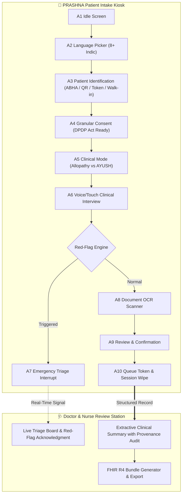

<div align="center">

Drive Link for PPT:
https://drive.google.com/drive/folders/1OFHlPOfbhyytmVbMNWhZjeTK0p9dOYdn?usp=sharing

# PRASHNA · प्रश्न
### Multilingual OPD Intake Kiosk & Clinical Decision Support System

[](https://www.sih.gov.in/)
[](https://www.sih.gov.in/)
[](https://ayush.gov.in/)
[](https://hl7.org/fhir/R4/)
[](https://abdm.gov.in/)
[](https://vercel.com/)

<p align="center">
  <b>Bridging the OPD Communication Barrier with Voice-First Multilingual Triage, Confidence-Gated OCR, and Dual Allopathy/Ayurveda Decision Trees.</b>
</p>

[✨ Live Demo](https://prashna-tau.vercel.app) • [📖 Philosophy](#-clinical-philosophy--etymology) • [⚡ Key Features](#-core-innovations--features) • [🧭 Architecture](#-system-architecture) • [🚀 Quickstart](#-getting-started) • [🧪 Walkthrough Script](#-3-minute-judge-walkthrough)

</div>

---

## 🌐 Live Demo Deployment

The complete application is deployed live on Vercel:

👉 **[https://prashna-tau.vercel.app](https://prashna-tau.vercel.app)**

- **Production URL**: [https://prashna-tau.vercel.app](https://prashna-tau.vercel.app)
- **Deployment Platform**: Vercel Serverless Edge Platform
- **Zero Configuration**: Ready for instant interactive evaluation on desktop, tablet, and mobile devices.

---

## 📖 Clinical Philosophy & Etymology

In Ayurvedic medicine, accurate diagnosis (*Rogi Pariksha*) is traditionally anchored on three pillars (*Trividha Pariksha*):
1. **Darshana (दर्शन)** — Direct visual observation.
2. **Sparshana (स्पर्शन)** — Physical palpation and tactile examination.
3. **Prashna (प्रश्न)** — Thorough clinical interrogation and patient questioning.

An automated kiosk cannot lay physical hands on a patient (*Sparshana*) or replace visual clinical observation (*Darshana*). By naming this project **PRASHNA**, we define its exact scope: **assisting clinical inquiry through empathetic, multilingual questioning without overclaiming diagnostic autonomy**. Every record generated remains marked **DRAFT** until verified by a licensed clinician.

---

## ⚡ Core Innovations & Features

### 1. 🎙️ Zero-Typing Multilingual Voice-First Interface
- **Designed for Zero Literacy Barriers**: Patients can complete their entire intake using either spoken voice or intuitive visual cards.
- **22 Scheduled Indian Languages**: Native question trees for **Hindi (हिन्दी)**, **Marathi (मराठी)**, **Tamil (தமிழ்)**, **Bengali (বাংলা)**, **Telugu (తెలుగు)**, **Kannada (ಕನ್ನಡ)**, **Gujarati (ગુજરાતી)**, and **English**, architected to route all 22 scheduled languages through the same adapter.
- **On-Screen Live Audio Captions (`VoiceCaptionBar`)**: Spoken questions and instructions are visibly displayed in large bold text on every screen with an instant **"फिर सुनें / Repeat"** audio button.
- **Resilient Indic TTS (`makeTTS`)**: Web Speech synthesis with automatic voice matching across regional BCP-47 language tags.

### 2. 🎭 Interactive Animated Gesture Guides
Specially designed SVG and CSS micro-animations guide uneducated and elderly rural patients step-by-step:
- **Voice Gesture Guide**: Animated Indian patient character bringing the handset close to the mouth (5 cm distance), live pulsing mic button, animated soundwaves, 3-step guidance pills, and explicit Do's/Don'ts (*✔ Near mouth, ✖ Not far away*).
- **ABHA QR Scanner Guide**: Animated kiosk camera housing with green laser sweep line scanning across an ABHA card held by an animated hand, target corner locks, and checkmark pop.
- **Document Scanner Guide**: Flat tray placement animation preventing folded or skewed prescription scanning.

### 3. 🚨 Real-Time Clinical Red-Flag Triage Engine
A deterministic, rule-based safety engine evaluates every answer in real-time. If a life-threatening symptom is detected, the kiosk instantly alerts the nursing station without alarming the patient:
- **`CARDIAC`**: Acute coronary syndrome (chest pain radiating to arm/jaw, diaphoresis, dyspnea). Target: ECG within 10 minutes.
- **`STROKE_FAST`**: Sudden neurological deficits (facial droop, arm weakness, speech slurring). Target: Immediate CT scan.
- **`RESPIRATORY`**: Severe dyspnea / stridor / impending respiratory failure.
- **`ANAPHYLAXIS`**: Sudden onset urticaria with respiratory compromise or hypotension.
- **`SEPSIS_SIRS`**: Fever/hypothermia with altered mentation and tachycardia.
- **`MENINGITIS`**: Fever with severe headache, neck stiffness, or photophobia.
- **`GI_BLEED`**: Hematemesis, melena, or acute abdominal guarding.

### 4. 🌿 Dual-Paradigm Clinical Engine
- **Allopathy Mode**: Systematic Chief Complaint breakdown using the **SOCRATES** pain assessment framework (*Site, Onset, Character, Radiation, Associated symptoms, Timing, Exacerbating/Relieving factors, Severity 0–10*).
- **AYUSH Ayurveda Mode**: Full **Dashavidha Pariksha (दशविध परीक्षा)** intake:
  - *Prakriti (प्रकृति)* & *Vikriti (विकृति)*
  - *Sara (सार)*, *Samhanana (संहनन)*, *Satmya (सात्म्य)*, *Satva (सत्त्व)*
  - *Ahara Shakti (आहार शक्ति)* & *Vyayama Shakti (व्यायाम शक्ति)*
  - *Vaya (वय)* & *Pramana (प्रमाण)*
  - Core metabolic indices: *Agni (अग्नि)*, *Koshtha (कोष्ठ)*, *Nidra (निद्रा)*, *Ahara (आहार)*.

### 5. 📄 Confidence-Gated Document OCR
- Handles printed prescriptions, typed laboratory reports, and handwritten doctor notes.
- **Strict Quality Gating**: If OCR extraction confidence falls below the clinical safety threshold (0.60), raw text is not hallucinated into the medical summary. Instead, the document is attached as an unextracted raw image with an audit flag for the doctor to review directly.

### 6. 🏥 ABDM M1–M3 & FHIR R4 Export
- **ABHA Integration**: MockABDM sandbox integration supporting 14-digit ABHA creation, QR code verification, and mobile OTP validation (`123456`).
- **Standardized FHIR R4 Bundle**: One-click generation and export of standard HL7 FHIR R4 JSON bundles containing `Patient`, `Encounter`, `Consent`, `QuestionnaireResponse`, `Observation`, `Condition`, and `Provenance` resources.

### 7. 🔒 Strict Privacy by Design & Zero-Retention
- **Session Wipe**: At the end of every intake, all temporary audio buffers, in-memory transcripts, and scanned document images are wiped immediately (`SessionWipe`).
- No patient telemetry leaves the local hospital premises without explicit cryptographic consent.

---

## 🧭 System Architecture



---

## 🧪 3-Minute Judge Walkthrough

Follow this exact click-path during presentations to demonstrate all core SIH acceptance criteria:

1. **Language & ABHA Verification (Criteria 1 & 2)**:
   - Tap screen $\to$ Choose **हिन्दी (Hindi)** or **मराठी (Marathi)**.
   - Click **"मेरा ABHA QR स्कैन करें"** $\to$ Click **"स्कैन सिमुलेट करें"**.
   - Listen to the audio prompt $\to$ Toggle consent $\to$ Click **"मैं सहमत हूँ"**.
2. **Clinical Interview with Voice & Gesture Animations**:
   - Choose **एलोपैथी (Allopathy)** or **आयुष (AYUSH)**.
   - Observe the **Animated Patient Voice Guide** demonstrating proper mic distance (5 cm).
   - Press and hold **"बोलने के लिए दबाए रखें"** $\to$ Release $\to$ Observe ASR transcript, confidence score, and automatic answer selection.
3. **Simulate a Cardiac Red Flag (Criterion 3)**:
   - Select **छाती (Chest)** $\to$ **दर्द (Pain)** $\to$ **दाबने जैसा (Heavy/pressing)** $\to$ **बाएं हाथ में (Into left arm)**.
   - The kiosk triggers the **CARDIAC Emergency Alert**. Switch to the **Triage** tab to view the live red-flag alert timer and click **Acknowledge**.
4. **Confidence-Gated Document OCR (Criterion 4)**:
   - Advance to Documents $\to$ Click **Printed prescription** (passes confidence gate, extracts 3 medicines).
   - Click **Handwritten note** (low confidence < 0.60 $\to$ gates extraction, safely attaches raw image).
5. **Provenance Audit & FHIR Export (Criteria 5 & 6)**:
   - Open the **Doctor** tab $\to$ Click any patient field $\to$ Click **source** to view the exact audio transcript, input method, and timestamp audit trail.
   - Click **Export FHIR R4 Bundle** to preview and download the validated HL7 FHIR JSON.
6. **Session Wipe Guarantee (Criterion 7)**:
   - Return to kiosk $\to$ Complete review $\to$ Done screen displays token number, queue wait, and executes **Session cleared**.

---

## 🚀 Getting Started

### Prerequisites
- Node.js 18.0 or higher
- npm 9.0 or higher

### Installation & Local Run

```bash
# 1. Clone the repository
git clone https://github.com/ashmitsahu1812/sih_2026.git
cd sih_2026

# 2. Install dependencies
npm install

# 3. Start local development server
npm run dev
```

Open **`http://localhost:5173`** in your browser.

### Available Scripts

| Command | Description |
|---|---|
| `npm run dev` | Starts Vite dev server with hot module replacement at `localhost:5173` |
| `npm run build` | Compiles optimized production bundle into `dist/` |
| `npm run preview` | Serves the production build locally for verification |
| `npm run dev -- --host` | Exposes local dev server to your LAN (for testing on tablets/mobile) |

---

## 🛠️ Technology Stack

- **Core Framework**: React 18 with modern React Hooks & Functional Architecture.
- **Build Tooling**: Vite 5 for fast bundling and hot module replacement.
- **Styling**: Tailored Design System with CSS-in-JS Tokens, Responsive Glassmorphism, and HSL palettes.
- **Icons & Visuals**: Lucide Icons & Custom SVG Vector Medical Illustrations.
- **Speech Technologies**: Web Speech API (`SpeechSynthesis` & `SpeechRecognition`), Bhashini/AI4Bharat IndicConformer schema.
- **Healthcare Interoperability**: HL7 FHIR R4 JSON Schema, ABDM Milestone 1–3 Architecture.
- **Deployment**: Vercel Serverless Edge Platform.

---

## 👥 Team Stack Overlords

- **Event**: Smart India Hackathon 2026
- **Problem Statement**: PS 26047
- **Organization**: Ministry of Ayush / All India Institute of Ayurveda (AIIA)
- **Repository**: [github.com/ashmitsahu1812/sih_2026](https://github.com/ashmitsahu1812/sih_2026)

---

<div align="center">
  <sub>Built with ❤️ for accessible healthcare delivery across India.</sub>
</div>
